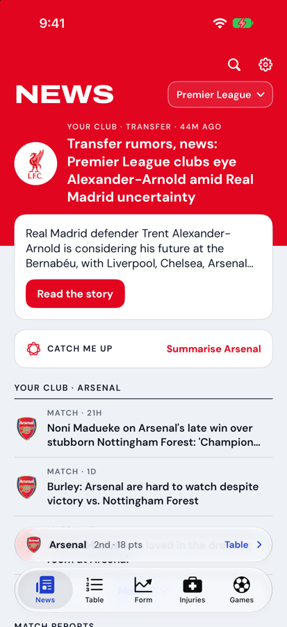
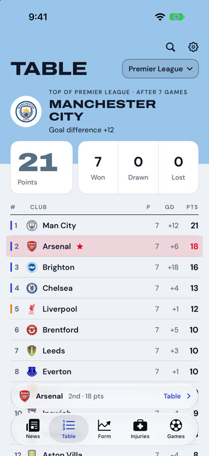
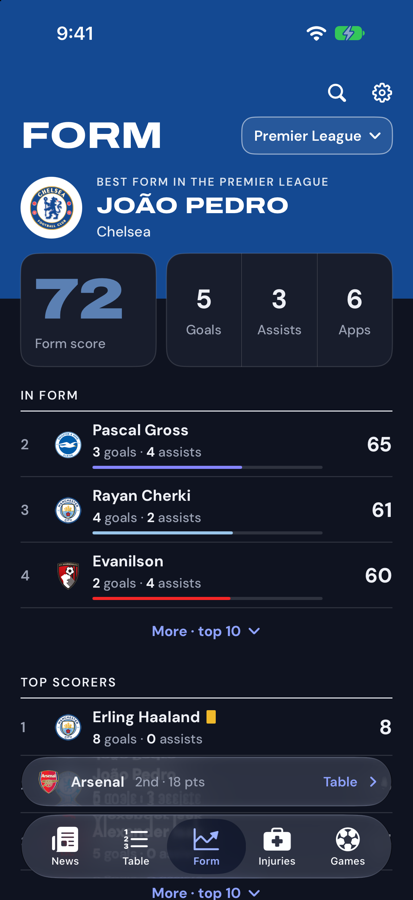
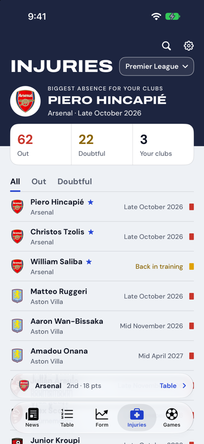
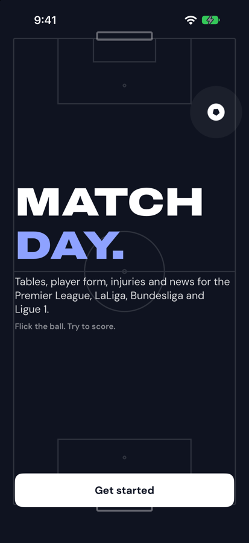

# Matchday

A native iOS app for football fans following the **Premier League, LaLiga, Bundesliga and Ligue 1**. It has live tables, news written from match data, a player Form score, injuries, and a daily quiz with a leaderboard. It's built in SwiftUI with no third-party SDKs.

| Welcome | News | Table |
|---|---|---|
|  |  |  |
| **Form** | **Injuries** | **Games** |
|  |  |  |

## Features

**Football**
- **News** for your league, in sections: your club, match reports, transfers, injuries. It's written from match data, so no one else's articles are copied.
- **Tables** for all four leagues, with your club highlighted.
- **Form score (0–100)** for every player. Each player is rated against others in their position, per 90 minutes, with recent games weighted more. A plain-language "Why 96" explains each score, and you can share a player's card as an image.
- **Injuries**: who's out, who's doubtful, and when they're expected back.
- **Your club**: the app takes on your club's colours, and your club's stories come first.
- **Search** players and clubs across all four leagues.

**Games**
- **Daily quiz**: five questions a day, different for every player, mixing classic trivia with questions built from today's live data.
- **Leaderboard**: today and all time. Server-side rules reject impossible scores, and the board is load-tested with 1,000 players at once.
- **Form duel**: tap whichever of two players has the higher live Form score.

**iPhone features**
- Home Screen and Lock Screen widgets for the league table and the form leader
- Siri and Shortcuts ("Who's top of the league in Matchday?")
- iOS 26+: **Catch me up** uses Apple Intelligence to write a three-point summary of your club's news, on the iPhone itself
- iOS 27: swipe a club to follow it, drag to reorder your leagues, and a tab bar that shrinks as you scroll
- Works offline from saved data, opens instantly and refreshes in the background
- Dynamic Type, VoiceOver labels, and light and dark mode

**Accounts and privacy**
- Sign in with a username, email (Firebase), Apple or Google
- An age check runs before sign-up. Under-13s use guest mode, where nothing leaves the iPhone.
- Deleting your account removes everything, including your leaderboard data
- No ads, analytics or tracking

## Tech

| | |
|---|---|
| UI | SwiftUI, iOS 17+ (newer features behind `#available`) |
| State | `@Observable`, Swift concurrency |
| Data | Sportmonks, through Matchday's own Cloudflare Worker (`server/`), which caches responses and keeps the key off the phone. Disk and memory cache with offline fallback |
| Accounts | Firebase Authentication REST API, Keychain, PBKDF2 for local passwords |
| Leaderboard | Cloud Firestore REST API with security rules |
| On-device AI | FoundationModels (weak-linked) |
| Extensions | WidgetKit, App Intents |
| Tests | XCUITest feature, reliability, chaos (fault injection) and compliance suites, plus a 1,000-player load test |

Firebase and Google sign-in are called over plain HTTPS, so there are no CocoaPods or Swift packages.

## Getting started

**You'll need** Xcode with the iOS 27 SDK, and an iOS 17+ simulator or device.

1. Clone the repo.
2. Copy the secrets template. Your copy is git-ignored, so your keys stay on your Mac:
   ```bash
   cp docs/Secrets.swift.example Shared/Secrets.swift
   ```
3. Start the data server, which serves sample data until you add a Sportmonks key:
   ```bash
   cd server && npm run dev
   ```
4. Open `Matchday.xcodeproj`, choose an iPhone simulator and press **⌘R**.

The app runs with every value in `Secrets.swift` empty. Email accounts, Google sign-in and the leaderboard each turn on once you fill in their value. You'll find setup steps for Firebase, Google sign-in, the server and the App Store release in [`docs/NOTES.md`](docs/NOTES.md) and [`server/README.md`](server/README.md).

## Tests

Press **⌘U** on an iPhone simulator. DEBUG-only launch flags sign in a test account, so you don't need a real one.

| Suite | What it covers |
|---|---|
| `NewFeatureTests` | Swipe to follow, reorder leagues, Catch me up, daily quiz, leaderboard end to end |
| `ReliabilityTests` | Offline mode, cold-launch time, a tour of every tab and league |
| `ChaosTests` | Every screen while requests time out, drop, error or return garbage |
| `ComplianceTests` | Age gate, guest mode, legal pages, reporting and hiding names |

`LoadTest/` simulates 1,000 players signing in and playing at the same moment, against the local Firebase emulator with the real security rules. See `LoadTest/README.md`.

## Project layout

```
Matchday/          The app: screens, onboarding, auth, games, legal, iOS 26/27 features
Shared/            Shared with the widget: models, data server client, cache, theme, fonts
MatchdayWidget/    Home Screen and Lock Screen widgets
MatchdayUITests/   UI test suites
server/            Cloudflare Worker between the app and Sportmonks
LoadTest/          1,000-player Firebase load test (emulator)
legal/             Web versions of the legal pages
docs/              Screenshots, development notes, secrets template
```

## Disclaimer

Matchday isn't affiliated with any league, club or data provider. Club names and news belong to their owners.
